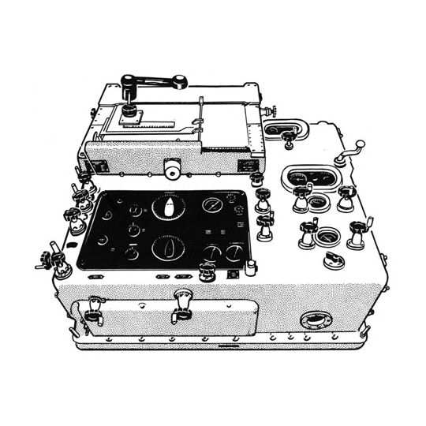

# Rangekeeper

Rangekeeper is the modelling engine: a Python library for real estate financial
modelling, cashflow forecasting and scenario analysis. It separates project facts and equations in a
`Model`, investigation choices in a `Specification`, and finalized evidence in a
`Run`. Immutable revisions retain units, identity and provenance.

Known-data calculations support DCF analysis. The execution layer solves declared
finite affine equations with Pyomo/HiGHS and independently checks candidate outputs.
Public authoring APIs and C# Grasshopper components connect reviewed data and
design models to canonical records. Polars serves detached tables and CSV.

This checkout contains a pre-1.0 redesign that is not yet the published PyPI API.
Use the source installation instructions and the upgrade guide together.
The [package ownership and import guide](docs/concepts/architecture.md)
lists the current namespaces; `Model`, `Specification` and `Run` remain root imports.

| Project or guide | Start here |
| --- | --- |
| Python package | [Installation and extras](docs/guides/installation.md) |
| Contributing | [Formatting and writing conventions](docs/contributing/README.md) |
| Architecture and APIs | [Documentation index](docs/README.md) |
| Executable examples | [Examples and walkthroughs](docs/guides/examples.md) |
| Schema and generation | [Schema guide](docs/contributing/schema.md) |
| Rhino/Grasshopper | [C# authoring and host checks](docs/guides/grasshopper.md) |
| Older consumers | [Upgrade guide](docs/guides/upgrading.md) |
| Verification | [Checks and limits](docs/contributing/verification.md) |
| Conduct and citation | [Code of conduct](CODE_OF_CONDUCT.md), [citation metadata](CITATION.cff) |

The walkthroughs follow Geltner and de Neufville's
[Flexibility and Real Estate Valuation under Uncertainty](https://doi.org/10.1002/9781119106470).
Historical plans and captured acceptance results are linked from the documentation
index. The [Windows connector gate](docs/contributing/windows-acceptance.md) remains
open. The [retirement guide](docs/contributing/legacy-retirement.md) records the
removed predecessor runtime.

### Library boundary

Rangekeeper provides canonical models, schemas, validation, calculations,
execution, native IO and local display. Source ingestion services, access policy
and application interfaces are separate consumer responsibilities.

See the [breaking upgrade guide](docs/guides/upgrading.md). The acausal walkthrough is maintained on
[`codex/walkthrough-acausal`](https://github.com/daniel-fink/rangekeeper/tree/codex/walkthrough-acausal/examples/walkthrough).
`develop` preserves the original `walkthrough/` sources. See the
[walkthrough branch procedure](docs/guides/walkthroughs.md#branches-and-publication).
