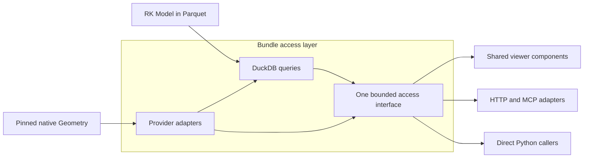

# ADR-008: Rangekeeper Bundle contract

Terminology and scope update, 14 October 2026: use **Rangekeeper Bundle**,
shortened to **Bundle**, for the outer immutable deliverable. Model remains the
canonical object. Speckle Bundle names native provider content. Model-only Bundles
are included in the target. Existing format/API names and the historical SQLite
record remain unchanged. Follow the
[contributor branch instructions](../contributing/README.md#working-folder-and-branches)
for reviewed integration into `develop`. Development integration is separate from
format approval and publication.

Status: Bundle contract, Entity-to-source-element mappings, separate provenance
and Parquet/DuckDB architecture agreed on 13 October 2026. Application/transport
ownership and the greenfield Interface were clarified on 14 October 2026. A
[concrete local candidate](../reference/bundle.md) is implemented in 0.10.0.dev3.
Implementation does not close the full P1–P8 acceptance matrix below. The SQLite development experiment is retained as earlier evidence.
It does not implement this contract.
The candidate adds Model schema 0.8.0 and optional Bundle IO. Public-format
adoption remains subject to the concrete review and conformance gates.

## Intention

Support source files → informed user decisions → a reproducible RK Model →
inspection. Keep Geometry beside the Model, with explicit, verifiable links
between them. The same Bundle must support independent browser, ChatGPT and
future native interfaces without making a renderer part of RK semantics.

## Contract and terms

**A Bundle contains a main Model and selected investigation records with their
interpretation dependencies. Each spatial Model owns one exact Geometry pin and
its mappings. Equal pins can share retained native bytes.**

| Term | Meaning |
| --- | --- |
| Model | The canonical RK Model, including its Geometry pin and mappings under candidate schema 0.8.0. Use “new Model” when this content changes; no separate “RK revision” object is introduced. |
| Geometry | The retained spatial source dataset, in its declared provider format. This includes source objects, properties, relations, geometric representations and required assets. The term does not restrict its content to meshes or flatten it into RK entities. |
| Rangekeeper Bundle (Bundle) | The immutable delivery unit containing a main Model, selected Models/Specifications/finalized Runs, exact dependencies, a manifest and declared Geometry. The manifest records identities, format pins and integrity information. |

The user agreed the investigation handover scope on 14 October 2026. The expanded
`2-proposal` candidate retains input/output Models, composed Specifications, selected
Runs and their exact dependencies. It preserves Model-only delivery. Historical
predecessors and workspace state are not copied automatically. The public reader
acts as a read-only resolver; Core manages export/import and further operations.
See the [current format reference](../reference/bundle.md). This supersedes the
one-Model restriction; earlier proof and P1–P8 acceptance records remain dated.
The user approved the concrete candidate for T2 development and local Projects
adoption. Stable release and the remaining acceptance matrix are separate gates.

The Model's pin must identify exact Geometry content by a digest, its provider and
format/schema identity, and its source version/address when available. A mutable
alias such as `latest` is not a pin. A different pinned source version creates a
new Model even when source bytes happen to match. Record an unavailable source
version as unavailable; do not invent one or use a URL as an integrity check.

### Entity-to-source-element mappings

Mappings belong to the Model. Each mapping associates **one RK Entity with one
source object or structural grouping element in the pinned Geometry dataset**.
An Assembly qualifies because it is an Entity subtype. The association means that
the source element corresponds to the Entity for navigation and selection; it
does not assert that the two records have identical semantics or properties.

| Constraint | Required behaviour |
| --- | --- |
| RK endpoint | An Entity present in this Model, including an Assembly. Values, Relationships, Labels and other records are not endpoints of this mapping. |
| Geometry endpoint | An explicitly typed source object or structural grouping element. In the first Speckle profile, allow objects and nodes of kind `LEVEL` or `CONTAINER`. |
| Source identity | Resolve a unique element in the exact pinned Geometry. Retain its provider-defined namespace, scope and any required placement selector. Do not interchange object, node and geometry IDs or treat an application ID as globally unique. |
| Cardinality | Allow many-to-many associations across mapping rows. Entities can have no mapping, and source elements can remain unmapped. Reject duplicate endpoint pairs and unresolved or ambiguous selectors. |
| Rendering | Resolve representations and transforms through the Geometry adapter after resolving the source element. Raw meshes, geometry blobs, materials and instance-definition nodes are not mapping endpoints. |

For example, one RK apartment can map to several Speckle room objects; an RK
storey can map to a Speckle `LEVEL` node. Several RK Entities can intentionally map
to the same source object. A reverse selection must return all associated Entities,
not choose whichever row was read last. Joining mappings must not silently multiply
RK Values in a calculation or aggregate.

Selecting a mapped group uses an explicit source-membership query to find its
members. Do not equate that membership with RK Assembly membership. A viewer may
also derive an Assembly's highlights from its mapped RK members; report that as a
derived selection, without inventing a direct source mapping. A node kind outside
the permitted set requires a reviewed profile extension.

### Separate provenance

An Entity association answers **which source elements correspond to this Entity**.
Provenance answers **what evidence supports this recorded content**. Keep property
and relation evidence in RK's existing Source, Location, Claim and Fact structure,
defined in [the provenance schema](../../schema/provenance.yaml).

For a Value taken from a source property, a Location identifies the exact source
edition, element and property path; a sourced Claim supports the Fact for that
Value. Evidence from a source relation can support a Fact for an RK Relationship
through the same mechanism. Derived Claims retain their inputs and method. These
references do not become Entity mapping endpoints, and an Entity mapping does not
automatically accept any source property or relation into RK.

When evidence addresses the Bundle's Geometry, resolve it against the same exact
Geometry pin. Other evidence sources remain valid; provenance does not require a
Geometry association. Concrete Location address keys and their validation belong
to step A and must preserve the provider's identity and property/relation scope.

### Provider-neutral schema vocabulary

Use **Geometry** for the canonical concept in documentation, schema types and
public APIs. Use provider-neutral field names for its pin, descriptor and mappings;
do not introduce a canonical `SpeckleBundle` type or `speckle_*` fields. Keep
provider-specific names in adapter implementations and provider metadata. This is
the naming rule implemented in candidate schema 0.8.0; its installed fields are
documented in the [Bundle reference](../reference/bundle.md).

The Geometry descriptor must distinguish:

| Information | Purpose |
| --- | --- |
| Provider and format | Select the appropriate reader/validator without changing the Geometry concept. |
| Format/schema version and exact specification pin | State which source contract defines the retained data. Keep the upstream release label separate from the executable specification version/hash. |
| Content digest and required file inventory | Identify the exact retained Geometry independently of its storage location. |
| Source address and version, when available | Preserve provenance in the provider's own namespace. These values do not replace the content digest. |

The field layout and validation types belong to step A. Provider identifiers must
be extensible; Core implements a narrow pinned Speckle profile. An unsupported provider or
schema must produce an explicit unsupported-format result, not a fallback to the
Speckle decoder. Replacing the provider or changing the pinned format/schema is a
pin change and therefore creates a new Model and Bundle. This boundary permits
future providers; it does not imply automatic or lossless format conversion.

### First Geometry implementation: Speckle 2026.9

The first provider target is **Speckle**, using its **2026.9 object-model/bundle
schema**. Core implements a narrow pinned profile; broader native formats and
live producer compatibility remain separate acceptance work. Geometry is stored as the native Speckle bundle in that profile. Keep
“Speckle bundle” for descriptions of that concrete encoding, not as the canonical
RK type or the name of the second Bundle component.

The 2026.9 release label is not the bundle specification's own `schema_version`
or `specHash`. Pin the exact specification commit/lockfile and decoder versions
when implementing this profile; do not use `2026.9` alone as its integrity or
compatibility check. Retain Speckle project/model/version addressing in provider
metadata when available. Speckle object IDs, relation node IDs, geometry IDs,
application IDs and instance paths retain their distinct source meanings.

The current retained object-graph capture is a legacy Speckle encoding. It does not
implement or prove 2026.9 native-bundle support. Do not relabel that fixture, codec
or its recorded evidence as 2026.9 data.

### Change rules

| Change | Model | Geometry | Bundle |
| --- | --- | --- | --- |
| RK domain content changes | New Model | Same Geometry may be reused | New Bundle |
| Geometry content changes | New Model, because its pin changes | New Geometry content | New Bundle |
| Pinned source version changes | New Model, even if source bytes match | Retain exact content and new version address | New Bundle |
| Geometry provider or pinned format/schema changes | New Model, because its pin changes | New descriptor and exact content pin | New Bundle |
| Mapping or canonical association changes | New Model | Same Geometry may be reused | New Bundle |
| Model pin or other canonical Bundle content changes | New Model if Model content changes | Exact content remains pinned | New Bundle |
| Camera, selection, renderer conversion or render cache changes outside canonical contents | Same Model | Same Geometry | Same Bundle |
| Copy, archive compression, RK Parquet layout or derived index changes, with identical canonical contents and format pins | Same Model | Same Geometry | Same Bundle; delivery file hash may differ |

Stable Entity and Value UUIDs can persist across Models. The Model identity must
change when its canonical content changes. Reject any attempt to publish one
Model identity with a different Geometry pin or mappings. Never silently update
Geometry under an existing Bundle. Retaining unchanged Geometry in several
Bundles is valid; each Bundle must resolve its exact content independently.

This rule applies when a Bundle is built or published. Editing can use a mutable
workspace before publication; it does not mutate an already published Bundle.

### Integrity and physical storage

Use **RK schema-derived Parquet tables, adjacent native Geometry files, and DuckDB
for queries** as the agreed spike architecture. This supersedes both the earlier
“one Model = one physical SQLite file” proposal and SQLite as the target canonical
RK store. A portable container can hold a manifest, RK Parquet files and the
original Geometry files. Parquet is a table format, not the outer Bundle archive.
The archive, concrete table layout, compression settings and canonical digest
algorithm still require step A proof and review. Native Geometry bytes must survive
packaging unchanged, including the provider's own compression and file layout.

Separate logical Model/Bundle identity from a delivery file's byte hash. The
Geometry content digest must cover a defined, complete source file inventory.
The Bundle manifest binds the Model and Geometry and their required format/schema
versions. There must be no circular hash: the Model pins Geometry; the outer
Bundle identifies the Model and Geometry. The Model must not contain its enclosing
Bundle digest. Derived database indexes and rendering caches cannot become new
authorities for mappings or source content.

Validate the pin, contents, source selectors, RK targets and required asset closure
before accepting a Bundle. A valid package does not prove that a user's source
interpretation is correct. Source acceptance remains an explicit ingestion step.
There is no automatic bidirectional synchronisation between Model and Geometry.

## Reader and application boundaries

RK owns canonical records, Bundle identity and validation, the schema-derived
table mapping and its lossless reader/writer. DuckDB stays in optional IO code;
domain imports need no database, transport SDK or application interface.
Canonical reconstruction is distinct from native Geometry decoding.

Consumers compose the reader with provider adapters, registered storage, access
policy and rendering. Their Python, HTTP or other transports must preserve the
same exact identities and validation rules. A retained Bundle can be read without
an ingestion workspace, source credentials, source network, chat or LLM. Keep
acquisition separate from decoding. The [public reader reference](../reference/bundle.md)
defines the installed RK API; application integration requires its own evidence.

## Parquet storage and DuckDB queries

Expose **one Bundle access layer** for Model queries, source queries, Entity
associations, provenance, geometry representations, placement and assets. DuckDB
and provider adapters are internal tools of that layer. They are not separate
public services. All operations share exact Bundle/Model identity, authorisation,
source resolution and cache scoping. HTTP, MCP and local callers use the same
operation semantics through their host adapters.

Structured results and streamed assets can use different response forms within
this interface. Ordinary queries still avoid geometry-blob reads. DuckDB can read
geometry blobs stored in Parquet; the provider adapter interprets their encoding,
representation roles and placement. The renderer chooses the display conversion.
One access layer does not require a separate server process for each internal tool.

Adopt the separation of columnar data, explicit relations and geometry used by
Speckle, while retaining RK's own schema and domain meaning. Do not encode all RK
records as Speckle objects or replace typed RK Values, units and provenance with an
untyped EAV store. EAV can serve source-variable properties where appropriate.

| Component | Role and authority |
| --- | --- |
| RK LinkML schema and generated contract | Authority for RK records, fields, references and semantic validation. Drives the versioned Parquet mapping; do not maintain a second handwritten domain schema. |
| RK Parquet tables | Lossless serialization of Model content, including Entity associations and separate provenance. Preserve presence versus null, scalar/union types, units, ordered and empty collections, ownership and UUID references. |
| Native Geometry dataset | Retained provider data, including its properties, relations and assets. The Speckle adapter reads its native Parquet tables; other providers can use other formats. |
| DuckDB reader inside Bundle access | Queries RK tables and supported Geometry tables, joins through explicit Entity mappings, and supplies bounded results. An embedded query engine, not the Model's identity or a required `.duckdb` delivery file. |
| Provider adapters inside Bundle access | Interpret source identities, properties, relations, geometry encodings, representation roles, placement and assets under the shared identity/access rules. |
| Bundle access contract and projections | One meaning for object, Value, evidence, membership, graph, source-selection and asset operations across hosts. Interface owns presentation projections; Core owns authorised service access. |
| Application registry and policy | Consumers own registered Bundle access, caller scope, sessions and disposable indexes outside canonical storage. |

The first service path exposes Bundle access with DuckDB and provider adapters
behind its authorised operations. Standalone
and focused clients request bounded data through their host adapters; they do not
need to download the whole Bundle, execute arbitrary SQL or run DuckDB-Wasm.
Offline local readers can use the same query contract. Browser-local engines and
future native implementations need their own conformance and performance evidence.

Queries carry exact Bundle/Model identity, validated scope and canonical IDs.
Use stable ordering, pagination and explicit incomplete/error results. Separate
object/value/evidence/graph reads from geometry-blob loading. Bound output size and
query work; a row limit alone does not bound scanning or memory. Measure cold/warm
lookup and join latency, bytes read and peak memory with declared fixture sizes.
Record archive extraction and cache costs separately. Do not assume Parquet provides
indexed point-lookup behaviour or that joins are fast enough without measurement.

Use one reusable conformance fixture set for reconstruction and query results.
Compare the DuckDB reader with a validated in-memory Model and source-adapter
oracle. Apply the same cases to each supported host projection or future reader. A projection
must carry Bundle/Model identity, publish only when complete, reject stale content,
and be removable and rebuildable without changing the Bundle. Preserve all
Entity candidates for a reverse source lookup and keep evidence retrieval separate.

The storage mapping must reconstruct the complete Model from the Parquet tables;
reading a retained JSON document alone is not a round-trip proof. Exact transport
hashes and semantic identity have separate purposes. RK row-group layout, table
ordering where non-semantic, and compression changes must not change logical
identity. Re-encoding retained Geometry changes its exact-content pin under this
contract. Step A must define and test this distinction before format adoption.

The current Interface uses shared components and the Core query service.
Payload/Next and their collections are excluded from that runtime. Derived host
projections, operational authorship and caches remain outside published Bundles
and canonical provenance. The historical Payload experiment below retains its
original scope; it is not a current integration task.

Primary references: [Speckle columnar property store](https://docs.speckle.systems/next/developers/object-model/overview#columnar-property-store),
[Speckle object/node definitions](https://github.com/specklesystems/speckle-bundle-spec/blob/main/GLOSSARY.md),
[DuckDB Parquet support](https://duckdb.org/docs/current/data/parquet/overview.html), and
[Payload v4 migration guide](https://payloadcms.com/docs/beta/migration-guide/v4).
These support the architecture choice; they do not establish local acceptance.

## Ownership and geometry boundary

| Owner | Responsibility |
| --- | --- |
| Rangekeeper | Canonical Model schema, Entity mapping and provenance contracts, Model identity, schema-derived Parquet serialization, reusable storage/query conformance and semantic validation |
| Geometry provider specification and adapter | Native source format and semantics; format-specific decoding and source integrity checks. Core supplies a narrow pinned native Speckle profile; broader support remains open. |
| Application services | Source acquisition, user decisions, builds, Bundle assembly/publication and authorised service access |
| User interfaces | Bounded projections, component queries, geometry conversion, rendering and host adapters |
| Hosting application | Bundle/Model catalogue, users, permissions and session state |

Specification and Run retain their separate meanings. Preserve provenance without
requiring every original source-workspace file to be a Bundle asset. The chosen
Geometry profile declares what it contains and what is required for offline use.

Use the Entity mapping contract above; do not introduce a geometry Value kind or
put source representations into characteristics through this change. Step A will
specify the mapping's concrete schema location. Do not copy a provider's geometry
schema into RK or force its entire graph into RK's schema.
Keep source properties and relations available for inspection even when they have
no RK counterpart. EAV means entity–attribute–value; a source property table using
that layout does not make the source graph equivalent to the RK domain model.

Preserve source units, coordinate systems, transform chains, nested instances and
placement identity. RK Assembly membership does not define spatial placement.
Provider-defined roles have distinct meanings: for example, Speckle's DISPLAY,
SOLID and CENTERLINE. Source containment and hosting relations must not automatically
become RK membership. Keep authored geometry and source appearance in Geometry.
An interface owns triangulation, level of detail, display-only overrides, camera
and caches. A different web or native renderer can display the same Bundle
differently without changing it. An edit to retained source geometry or placement
creates a new Model and Bundle.

Use format-specific adapters. In the Speckle implementation, native 2026.9 bundles
and legacy object graphs have different contracts. Do not require legacy root
objects, detached references or `__closure` fields in the native bundle contract.
The existing capture and viewer loader prove only the legacy path.

Primary references for the first provider:
[Speckle bundle specification](https://github.com/specklesystems/speckle-bundle-spec),
[2026.9 relations](https://docs.speckle.systems/next/developers/object-model/relations) and
[viewer bundle loading](https://docs.speckle.systems/next/developers/viewer/loading-bundles).
These define source formats and adapter options, not local implementation acceptance.

## Earlier SQLite experiment — not Package conformance

The [prototype](../../tools/sqlite_spike/package.py) derives record tables and
columns from the generated `src/rangekeeper/schema/slots.json` contract. That
contract comes from the authoritative LinkML schema. There is no second handwritten
list of domain fields and no dependency on Payload's physical database structure.

| Storage | Rule |
| --- | --- |
| `rk_<RecordKind>` | One row per embedded record, located by its original JSON pointer. Fields use exact JSON text. SQL NULL means absent; text `null` means present null. |
| `children` | Links embedded records to their containing slot and array position or mapping key. Empty containers, order and multiplicity remain intact. |
| `records` | Canonical UUID, record kind and nearest identified owner. Anonymous records have paths, not invented domain IDs. Opaque Claim content is not traversed. |
| `refs` | Schema-declared local UUID references. `Metadata.previous` remains an external revision reference in its original field; no predecessor is required. |
| `geometry` | Original UTF-8 object records, independently compressed, with SHA-256 checksums. Speckle IDs remain opaque transport IDs. |
| `geometry_refs` | Direct detached references only. Original closure declarations are retained and checked, but their transitive edges are not duplicated in this index. |
| `associations` | Validated legacy Model identity and Entity/Assembly association with a retained geometry record. |
| `documents` | Exact original Model JSON and the slot contract. These are comparison evidence; reconstruction reads generated record tables. |
| `package` | Format version, Model identity, checksums and geometry descriptor. |

This deliberately preserves values in JSON cells rather than choosing a SQL type
for every union. It proves lossless, schema-driven storage; it does not establish
the final numeric indexing or query design. Python Model validation remains the
semantic boundary. SQL constraints do not replace it.

The initial geometry codec is `speckle-object-transport/1`, tested with the retained
SpecklePy 3.0.7 capture. It checks root presence, detached references, closure IDs,
reachability and canonical associations. It rejects detected external file/blob
references. Other Speckle formats, external textures and general source-format
completeness need their own codec and conformance fixtures. Unknown source
semantics cannot be certified by a recursive JSON scan.

The complete source object graph is retained, including source BReps and existing
display meshes. Keeping a source display mesh does not require an interface to use
that mesh. The spike's alternate conversion is a planar quad test; it is not a
general BRep tessellator or a native iOS implementation.

### Experimental identity and publication

| Identifier | Meaning in this experiment |
| --- | --- |
| Model UUID | The unchanged public Model 0.7.0 identity; its current contract excludes geometry |
| Model digest | SHA-256 of validated Model JSON with sorted object keys, exact scalar types and retained array order |
| Package content digest | Model digest, geometry format/descriptor, exact geometry-record hashes and associations |
| Database file hash | Exact SQLite bytes, including physical layout and indexes |

Experimental consumers must pin the package content digest as well as the Model
UUID. Geometry can still change under the same legacy Model UUID because public
geometry fields and revision enforcement are deliberately not implemented yet.
Adoption must close that gap; a package digest is not a substitute for the future
Model identity rule. The digest is also not RK schema equivalence: array order and
original geometry encoding affect it. A storage/index change alone can leave the
content digest unchanged while changing the database file hash.

The builder validates input, writes a private database in one transaction, closes
it, verifies reconstruction and assets, then publishes with a no-overwrite file
link. It uses rollback-journal mode so the finished artifact has no required WAL
sidecar. This is local atomic publication, not a distributed publication protocol
or a cross-file identity registry. Power-loss durability and platform-specific
publication behaviour need separate acceptance before production use.

### Experimental queries and checks

The experiment provides bounded object-ID pages and direct Assembly membership
pages, canonical record lookup, geometry-object retrieval, Model reconstruction
and a full verification scan. Query tests deny access to the geometry and retained
document tables while object and membership reads run. Reconstruction is checked
against the retained document; derived lookup tables and geometry indexes are also
checked, so a missing index row cannot silently change a query result.

Object lookup reconstructs the selected record's full embedded content. It is not
yet a bounded value/evidence API. Opening loads the geometry-hash manifest but no
geometry blobs. Full validation intentionally reads all content and must precede
trusting a received artifact. The reader is an experiment for trusted local files,
not a hostile-file parser or an externally exposed SQL service.

See [the local evidence](../research/sqlite-model-2026-10-13/README.md) and
[repeatable commands](../../tools/sqlite_spike/README.md).

### Generator and host assessment

Stock LinkML 1.11.1 SQL generation was run against `schema/model.yaml`, with
SQLAlchemy 2.0.54. Both tested mappings emitted `Expression.Call_id` and
`Expression.call_id`; SQLite rejected the duplicate column name. The captured
DDL and errors are retained with the evidence. This result applies to those
versions and that input. It does not rule out fixing or configuring the upstream
generator. Production mapping needs explicit decisions about unions, field
presence, ordered collections, inheritance and local/external reference scope.

Payload generates its physical schema from collection configuration. An RK-owned
database does not automatically supply native Payload collection APIs or drawers.
The shared read-adapter step must compare a read-service adapter, a Payload projection and
the cost of retaining the native UI. Do not allow Payload development schema push
or host migrations to modify a published RK package.

The [Payload v4 migration guide](https://payloadcms.com/docs/beta/migration-guide/v4)
was checked during this work. This experiment imports no Payload API and changes no
Payload configuration. It establishes an independent boundary, not a v4 integration
pass. Repeat the Interface v4 procedure when implementing its adapter.

Primary references: [SQLite application files](https://www.sqlite.org/appfileformat.html),
[LinkML SQL generation](https://linkml.io/linkml/generators/sqltable.html),
[Payload SQLite](https://payloadcms.com/docs/database/sqlite), and
[Speckle object encoding](https://docs.speckle.systems/developers/sdks/python/concepts/objects).

## Spike steps, grouped turns and review

This ADR owns the canonical Bundle contract and P1–P8 criteria. Application
transports, browser components and hosted integrations have separate delivery and
acceptance procedures. Their results do not establish canonical conformance.

The Bundle contract, Entity mapping boundary, separate provenance and
Parquet/DuckDB direction are agreed. Implement the following steps in dependency
order; the earlier SQLite proof remains input evidence, not completion of step A.

| Step | Work and concrete result | Acceptance and user review |
| --- | --- | --- |
| A: Schema, Parquet and Bundle lifecycle | Specify provider-neutral Geometry types, Model-owned Entity mappings, separate provenance addresses, identity rules and migration. Derive Parquet tables from the RK schema; prove complete reconstruction and a DuckDB query prototype. Pin Speckle 2026.9 and its exact specification; build a native fixture, validator, shared conformance cases and offline reopen proof. Preserve the legacy reader boundary. | Pass P1–P5 below and measure representative P6 reads before storage adoption. Review the concrete schema, manifest, associations, provenance, table mapping, query costs, change cases and reopened artifact before adopting the public format and wiring hosts to it. |
| B: Bundle access and host adapter | Implement independent application operations for bounded Model/source/evidence and geometry/asset queries. Compose RK IO and provider interfaces; expose thin HTTP/MCP adapters and connect Interface. | Pass P6–P7 and standalone P8. Prove direct Python with transports absent, equivalent authorized transport results and offline reads without ingestion/source state. Measure query costs and verify client projections. Payload/Next are excluded. |
| C: Navigation and inspector | Use the selected Mantine Tree and AG Grid Community; finish occurrence, browse/inspect and restore rules; share the inspector and components between standalone and focused shells. | Use Interface's browsing matrix. Review the actual tree, selection and inspector behaviour after automated and browser checks. |
| D: Focused resources and workflow | Connect MCP Bundle access and component dispatch; verify real ChatGPT tree/inspector then graph/3D, standalone deep links, and build/reopen workflow. | Pass P8 in actual hosts. Review focused UI beside the full browser; test full-browser embedding separately if claimed. |

Each step can include implementation, fixtures, checks and a reviewable result in
one turn. B and C can share a turn. D can share a later turn with workflow checks
when access and dependencies are ready. The entire spike is not one unattended
turn: schema/artifact review after A and product review after B/C remain deliberate
checkpoints. User interpretation review belongs inside the ingestion workflow.
Routine reversible fixes and verification do not need separate permission stops.

Interface U0 and Core PA0 can run first: a clean Vite/Mantine/Community browser over
labelled synthetic Bundle projections and a direct-call fixture application
contract. Show UI promptly. A remains the gate for new Bundle integration; repeat
the same interactions with real access in B. Preserve earlier JSON/SQLite and
legacy Geometry evidence without treating it as native Bundle or ChatGPT acceptance.

### Bundle acceptance criteria

| ID | Required evidence |
| --- | --- |
| P1: Cardinality and identity | A valid Bundle contains a main Model, selected canonical roots and their exact interpretation dependencies. Reject missing/unselected records, wrong-kind references, mismatched pins, and reuse of a record identity with changed canonical content. Each spatial Model has one pinned Geometry dataset; equal pins can share native bytes. Also prove Model-only Bundles with no fabricated Geometry; reject a declared Geometry profile with missing data. |
| P2: Change matrix | RK-only, Geometry-only, source-version-only, provider/format/schema-only and mapping-only changes each produce a new Model and Bundle. Geometry-only changes cannot retain the old Model identity. Stable Entity/Value UUIDs and reuse of unchanged Geometry work. |
| P3: Integrity and reopening | Reopen a copied Bundle offline without the source server or original capture. Reject tampered/missing source files, wrong digests/versions and invalid mappings before publication. Preserve native Geometry bytes; verify all declared required assets. |
| P4: Source semantics and provenance | Test Entity/Assembly mappings to objects and allowed groups, many-to-many and absent mappings, ambiguous and namespace-colliding selectors, and all-candidate reverse lookup. Reject Value/Relationship/mesh endpoints and unsupported node kinds. Verify property/relation evidence through Source/Location/Claim/Fact independently of mappings. Test explicit source-group expansion, units, nested instances and transforms without inferring RK membership, placement or accepted content. |
| P5: Schema and storage | Reconstruct the complete Model from schema-derived Parquet tables under the new schema. Preserve field presence, scalar/union types, units, order, empty containers, ownership, references and provenance. Verify migration, neutral names, provider metadata and unsupported-format results. Test repacking without logical identity changes, exact Geometry-byte integrity, file hashes and no circular digests. A retained JSON-only read is insufficient. |
| P6: Bounded reads and conformance | Run object/value/evidence/membership/graph/source queries against the validated Model/source oracle and DuckDB, then each host projection. Check ordering, pagination, scope, all-candidate joins without accidental value multiplication, and explicit incomplete results. Ordinary reads must not load geometry blobs. Record cold/warm latency, bytes read, peak memory, rebuild cost and declared scale limits; test rejection of stale/incomplete projections and their rebuild without Bundle mutation. |
| P7: Interface independence | Two supported render conversions leave Model, Geometry and Bundle unchanged. Camera/selection/cache changes stay outside canonical contents. Host schema push and migrations cannot modify published Bundles. A quad conversion alone does not establish general BRep or native-app support. |
| P8: Host consistency | Full browser, focused resources and deep links carry the exact Bundle and Model identity plus canonical selection/scope. Reject stale cross-Bundle requests. Verify the same mappings/evidence in each claimed host, actual ChatGPT tool/UI exchanges, and standalone use without Payload, Next or ChatGPT. The v4 probe is legacy evidence only. |

The existing test `test_content_digest_separates_geometry_from_legacy_model_id`
records a legacy identity gap. It must not count as P2 acceptance. The existing
SQLite proof, planar quad, local browser and older v4 results establish only their
recorded scope. They do not accept the new schema, Speckle 2026.9 codec, ChatGPT,
native iOS, general BRep conversion or production service.

Before production adoption, also establish publication durability, migration and
codec support policy, access isolation, hostile-file handling and declared scale
limits. Cross-Bundle search belongs to a separate catalogue/index. Core ingestion
must remain usable without a viewer.

## Current status and consumer checks

Reconciled on 15 October 2026. Implementation: the expanded Bundle candidate and
selective post-open record reads are installed in RK 0.10.0.dev3. Verification:
[T1](../research/bundle-t1-2026-10-14/README.md),
[investigation handover](../research/investigation-bundle-t1-2026-10-14/README.md),
[T2 selective reads](../research/t2-technical-2026-10-14/README.md) and
[T3 integration](../research/t3-integration-2026-10-15/README.md) retain their recorded
scope. Acceptance: approved for T2 development and bounded local consumer adoption,
with full P1–P8 conformance still open. Release: no stable-format approval follows
from a development merge or that bounded approval. Edited historical extracts do
not supply new verification evidence.

Match each acceptance case to its evidence. Keep provider coverage, hostile-file
and durability limits, schema edge cases, render conversions and actual hosts
explicit. Public API or schema changes need a verified distribution and exact
consumer pins. Cold opening still reconstructs retained documents; isolated
reader timings do not establish service capacity. Walkthrough and native-host
checks, release approval and publication remain separate.

Amended by: [ADR-017](017-api-and-formats.md), accepted 2026-10-26. Bundle format 1 becomes stable at milestone 1.0.0b1.
